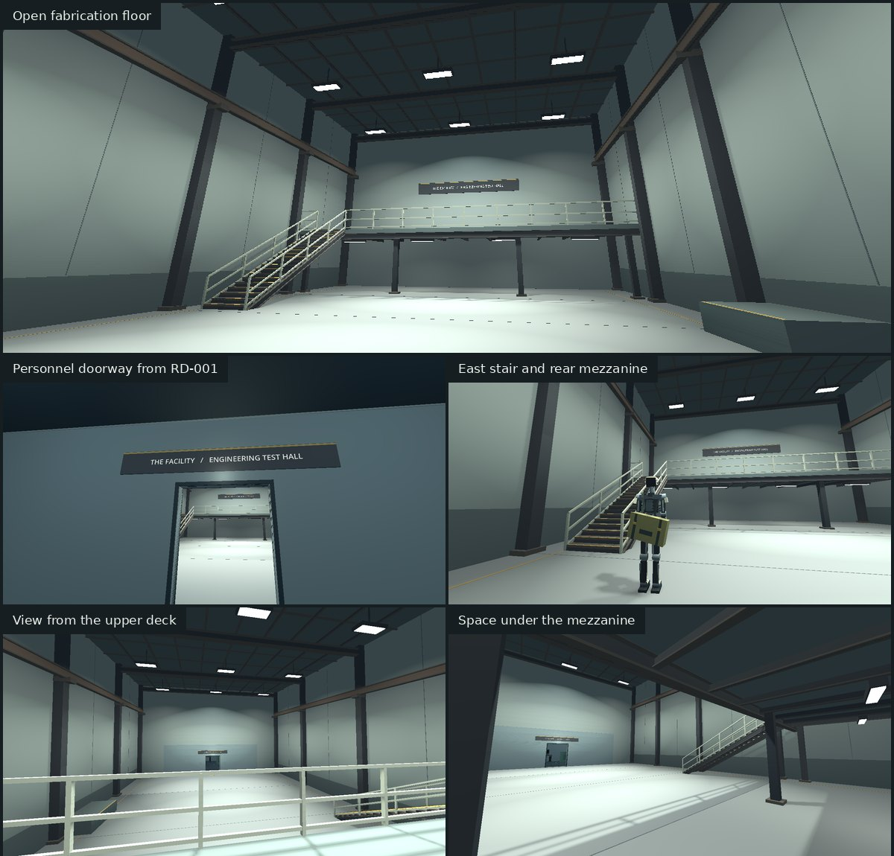

# RD-014A — Engineering Test Hall

The personnel opening in the south wall of the Systems Test Chamber leads into the hall. The two rooms share a floor datum and use the same Otis, carried items, camera systems, and Facility session.

| Feature | First-pass dimensions |
| --- | --- |
| Main floor | 18.288 × 24.384 m (60 × 80 ft) |
| Inside roof height | 11.35 m (37.2 ft) |
| Personnel opening | 1.80 × 2.45 m clear |
| Rear mezzanine | 18.288 × 5.384 m deck at 3.35 m above the slab |
| Straight stair | 1.8 m wide with 6.4 m of run, 20 visible treads, and rails on both sides |
| Mezzanine guard | 1.10 m high, with a full-height collision barrier |

The open slab leaves continuous central space for fabrication, welding, and assembly. The rear platform reserves floor area above and below for future storage, offices, machines and utility rooms. The east stair and wall-side columns keep that volume accessible. The small west-wall utility footing gives Otis a permanent ledge for traversal checks.

## Scene layout

`scenes/architecture/engineering_test_hall.tscn` is instanced at `(0, 0, 6.2)` in the Facility. Inside the hall, +Z points from the chamber doorway toward the mezzanine. The shell script builds the named groups when the scene runs, using its exported width, depth, ceiling height, deck dimensions, staircase run, and staircase inset.

| Group | Contents |
| --- | --- |
| Shell | Floor and roof slabs, perimeter walls, entrance infill, and west utility footing |
| Steelwork | Portal frames, wall-side runway girders, purlins, and roof panel supports |
| Mezzanine | Deck, supports, joists, stair geometry and collision, and guards |
| Lighting | High-bay fixtures, under-deck strips, and personnel threshold lights |
| Markings | Facility placards, aisle stripes, and footing edge paint |

Facility owns the aligned personnel opening and trims. The new scene owns the hall architecture. Future layout data should use hall-local transforms and remain separate from the shell and its painted markings. The runway girders are visual structure for now.

## Local playtest

Run the project in Godot 4.7.2 with **F5** or `godot --path .`. From Otis’s usual spawn, turn around and walk through the doorway marked **Engineering Test Hall**. The east stair is on your left when looking toward the rear deck from the doorway.

1. Walk and sprint through the threshold both ways. Use **Shift + W** for sprint.
2. Use **Space** to jump on the open floor or climb the low utility footing along the west wall. Tap **Alt** to crouch and hold **Alt** to go prone.
3. Walk up and down the east stair. At the upper landing, turn onto the open mezzanine and inspect the guardrails and lower bays.
4. Use **C** for the shoulder view and **K** for screenshot orbit. Hold **Q/E** to rotate the orbit while moving.
5. Return to the chamber and check the terminal, equipment, or physical test stations.

The treads are visible geometry over a smooth walking collider, so feet can pass slightly above or below individual treads. The shell uses fixed architectural lighting and basic finishes. Detailed machinery, enclosed partitions, and equipment layouts are future passes. Camera settings carry over from RD-013. The hall gives the shoulder camera more room for a hardware evaluation.

