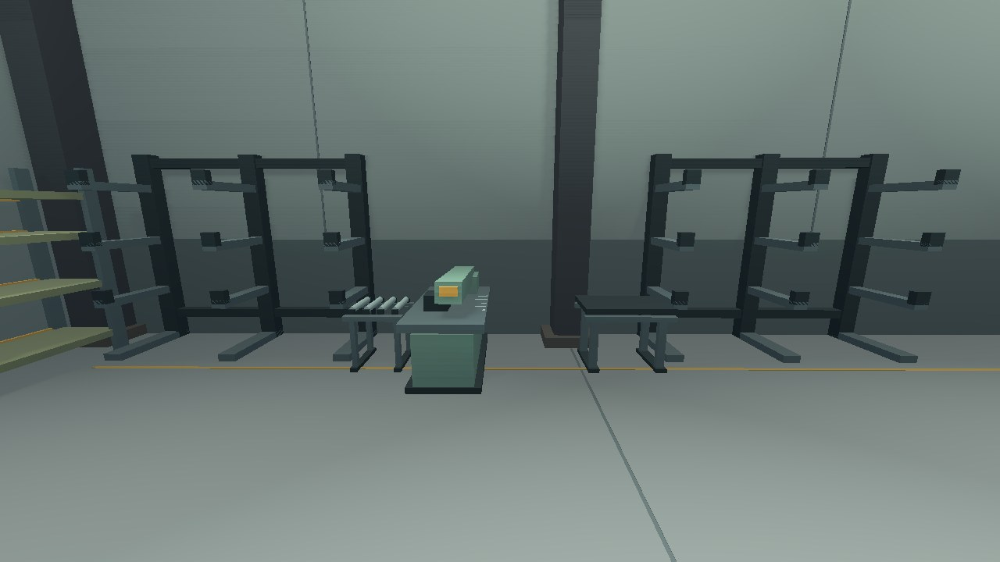

# RD-014C / RD-014C.1 — Shop layout and storage cells

The normal Facility launch loads the [approved schema-1 hall layout](../../data/layouts/engineering_hall_approved.json). RD-014C.1 changes two of its 26 source records, retaining both rack IDs and dimensions. The [original placements](https://github.com/TAM-Hiding/requisition-denied/blob/395bafba4054f02543ea02580cbdd9724a05da2f/data/layouts/engineering_hall_approved.json) remain available in Git history. Two standalone support records bring the initial editor list to 28 items. The original door records mark the fixed storage portals.

| Feature | Hall-local location or dimension |
| --- | --- |
| Storage A | Exterior of the west wall, entrance aligned to marker `(-9.0, 0.0, 2.75)` |
| Storage B | Exterior of the rear wall, entrance aligned to marker `(7.0, 0.0, 24.25)` |
| Clear cell interiors | Both 4.00 m wide × 5.00 m deep × 2.80 m high |
| Clear portal openings | 1.06 m wide × 2.18 m high |
| Mezzanine support | Existing deck at Y = 3.35 m |
| Cantilever racks | `(7.42, 0.0, 2.28)` and `(7.42, 0.0, 8.40)`, yaw π, arms toward the shop |
| Bandsaw | `(8.25, 0.0, 4.75)` |
| Infeed stand | `(8.25, 0.0, 3.99)`, 0.60 m deep |
| Outfeed support | `(8.25, 0.0, 6.55)` |

The storage cells use the original exterior wall as their front face. Each has a level floor through the portal, closed walls and ceiling, and fluorescent-style work lights. The workshop floor remains open. The stock rack frames sit just inside the east wall. The compact infeed stand aligns with the cutting bed and leaves a path from the front rack. The bandsaw and each support are separate static stand-ins.

## Playtest

Start Godot 4.7.2 with **F5**, or run `godot --path .` from the branch checkout. Turn around from the Systems Test Chamber spawn and enter the hall. Look for **STORAGE / A** near the front west wall and **STORAGE / B** on the rear wall under the mezzanine.

For layout editing, launch with `godot --path . -- --workshop-layout` using a debug build. Walk up the existing stair and press **L** on the deck. Spawn an item, or use the list to select equipment on the lower floor and choose **Move**. Aim at a clear area of the deck and confirm the preview. Grid snapping applies to X and Z. Elevation comes from the slab or deck face, with clearance checks for the full footprint and occupied volume. Save or export, restart, and select **Load…** to check the saved elevation.

Schema 1 still uses hall-local meters and yaw radians. Old files load at their original Y values. The two designated legacy rack IDs still load as open rack models. Importing an older save preserves its rack placements and its support records. Existing layouts that intersect the new door approaches require adjustment before loading. Saving a custom arrangement keeps it in a separate file. A fresh Facility still starts with the approved baseline until a custom file is loaded.

[Full layout editor controls and JSON format](../layout-editor/README.md)

[Infeed close-up](infeed-detail.jpg) · [Original hall and storage-cell preview](rd014c-preview.jpg)
