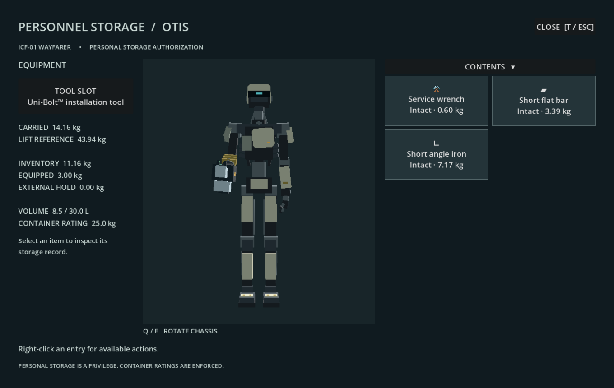
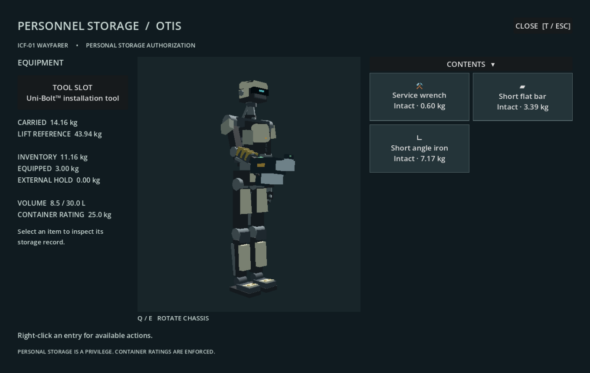

# Inventory foundation

RD-011 stores live physical items for the running session. An inventory entry references the same object that can be equipped or returned to the Facility. Its definition, condition, mass, metadata and tool state stay on that object. The screen sends transfer requests through the existing equipment controller.

## Controls

- **E → Store** transfers an eligible world object into personal storage.
- **T** opens or closes inventory. **Escape** closes it.
- Hold **Q/E** to rotate the preview. The actual player and aiming camera keep their orientation.
- Click an entry for identity, condition, mass and dimensions. Right-click for applicable actions.
- **Equip** selects the compatible tool slot automatically. **Unequip** returns its occupant to storage. **Retrieve into world** and **Drop into world** use collision-aware release.
- **Contents** collapses or expands the scrollable grid.
- Existing **1**, hold **E**, **G**, middle-mouse rotation and Uni-Bolt controls remain available during normal gameplay.

Opening inventory suspends movement input, tool activation and precision positioning. The Facility keeps simulating. Stored objects are frozen, hidden, removed from world collision and processing, and parented to the container. Input is routed through the modal before gameplay. Closing restores the prior mouse mode and placement suspension. Pending interaction holds and preview rotation on focus loss are cleared.

## Ownership and transfer architecture

| Component | Responsibility |
| --- | --- |
| ObjectDefinition | Existing authoritative definition plus optional equipment_slots metadata |
| InteractableObject | Existing live identity, state and ownership references |
| InventoryItem | A live body reference, occupied dimensions and optional interior transform |
| ContainerDefinition | Identity, type, volume, weight rating, insertion envelope and future interior scene |
| InventoryContainer | Contents, admission, occupancy totals, packing veto and manifest resolution |
| EquipmentController | Existing active tool slot, storage/equipment transactions and safe world release |
| InventoryScreen | Grid, context actions, load readout and input ownership |
| InventoryPreview | An isolated render world with visual copies of current modules and equipped item |

Transfers validate capacity, eligibility, destination ownership and collision clearance before committing. Equipment replacement checks capacity after excluding the outgoing stored item. If storage of the displaced tool is rejected, the candidate stays in its container and the current tool stays equipped. Container listeners are notified after completed transactions. Internal commit methods are reserved for the transfer coordinator.

Unsupported fixed fixtures, fastened assemblies, and actively manipulated objects are rejected. Eligible movable stock may be stored when its actual dimensions and mass fit. A heavy plate remains governed by existing supported dragging when outside inventory.

## Equipment compatibility

The initial registered active slot is **tool**, associated with the hand/tool interface. Carryable definitions authored before RD-011 default to that slot. New definitions can declare equipment_slots explicitly. Unregistered slots are rejected. A hands, feet or head item cannot silently occupy tool. Additional categories can register compatible slots and presentation adapters later. RD-011 retains one active tool slot.

The equipped Uni-Bolt is the original body. Its round identities, reserve, grade, removal behavior and timer remain authoritative. Storage snapshots include these values. Switching tools through inventory never builds another tool.

## Capacity and carrying load

The provisional personal container is configured in data/inventory/personal_storage.tres.

| Property | Initial value |
| --- | --- |
| Nominal volume | 30 litres |
| Structural weight rating | 25 kg |
| Insertion envelope | 60 × 40 × 25 cm |
| Number of cells | Grows with contents |

An item's bounds combine its active collision shapes and local offsets, rotations and body scale. The occupied volume is their bounding box volume, so hollow and irregular stock consume a conservative envelope. Sorted item dimensions must fit the sorted insertion envelope. Aggregate mass and volume must stay within the container's ratings. This approximation does not solve 3D packing.

InventoryContainer.packing_validator is an optional callable receiving a record and returning an empty string or rejection reason. Future physical packing can veto admission after the approximate checks.

OtisController.carrying_loads() reports inventory, equipped and externally suspended mass separately. Equipment precision placement already counts as equipment. Supported dragging contributes zero carried mass. The pressure plate receives body plus total carried mass. The chassis lift reference and container structural rating remain independent. This work adds load data without a new locomotion penalty.

## Versioned serialization contract

InventoryContainer.snapshot() returns a version-1 dictionary with container identity/type and stored records. Each contains stable IDs, definition paths where authored, names, mass, dimensions, volume, compatible slots, gameplay snapshots and interior transforms. Gameplay data uses Godot JSON.from_native Variant tags, normalized through JSON, so numeric types, vector properties and metadata keys have a JSON representation. Object references are excluded.

restore_manifest(data, registry) resolves IDs against already restored live world objects. The future world save system must first restore definitions, mutable gameplay state and tools/rounds, then supply a registry mapping IDs to those objects. Manifest resolution validates that state before changing ownership. It rejects duplicate IDs, foreign ownership, omitted currently owned objects, unsupported versions, malformed interior transforms and capacity violations. It does not instantiate missing objects, restore old ammunition over newer live state, or provide a whole-game save.

The runtime record references the authoritative object. Across-session saving is deferred. The tests round-trip manifests through JSON and check identity, mutable state and rollback.

## RD-012 physical-container contract

The future physical view and grid share these records. It will activate an isolated physics world only while inspected and use internal_pose to persist interior positions and orientations. Physical scale stays in metres. Presentation assistance must preserve packing dimensions.

Normal cursor movement inspects, highlights, selects or retrieves. Holding **RMB** enters temporary Plow Mode. Releasing it returns to selection. Plow physics, simplified boundaries, compliant walls and a deformable shell belong to that later view.

The container exposes empty, partially_full, full and bulging labels for future accessory presentation. Admission currently prevents overcapacity, so bulging is reserved for future compliant packing. There are no satchel meshes or physical interiors in RD-011.

## Verification and manual playtest

Run tests/validate.sh with GODOT_BIN pointing to Godot 4.7.2.

Store the wrench and several small scrap variants through E → Store. Open T, rotate with Q/E, collapse the grid, and inspect an entry. Right-click the wrench to equip it, then equip the stored Uni-Bolt and verify the displaced wrench stays in inventory. Unequip and retrieve both. Try storing long tubing, a large plate or an assembly and check the rejection feedback. Block the space in front of Otis and try retrieval, then move clear and retry.

While holding a workpiece, equip the stored gun with 1 and aim while repositioning Otis. Verify the workpiece stays pinned, then fasten it. Recheck heavy dragging, pressure plate operation, the ram and structural failures.

Independent review found pending E input, mixed-inventory tool selection, incomplete retrieval sweeps and missing container notifications. These were corrected with regressions. World-parent and scene-tree preconditions were also added before ownership changes.

Known limits include approximate volume packing, one active tool slot, no persistence across process exits, and symbolic category icons. The preview is a visual snapshot refreshed on opening and equipment changes. Existing chassis animation and head/tool synchronization are preserved.
