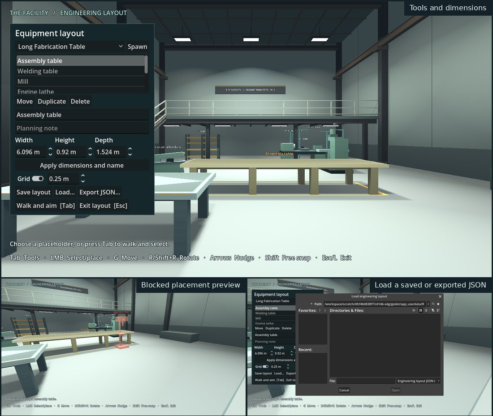

# RD-014B — Engineering layout editor

Run the project with **Godot 4.7.2** using **F5** or `godot --path .`. Turn around at the Systems Test Chamber spawn and walk through the signed Engineering Test Hall doorway. Press **L** on the main hall floor to open the editor.

Choose an entry from the catalog and press **Spawn**. Walk and point the crosshair at the floor. A cyan preview is clear to place and a red preview is blocked. Click to commit it. The panel list can select anything in the layout, including room and door markers.

| Control | Action |
| --- | --- |
| L | Open layout mode on the main floor or exit while walking |
| Tab | Toggle the tools panel and walking controls |
| Left click | Select under the crosshair or commit the current preview |
| G or **Move** | Pick up the selected placeholder for repositioning |
| R / Shift+R | Rotate the preview ±15° around Y |
| Ctrl+R / Ctrl+Shift+R | Rotate the preview ±1° |
| Arrow keys / Shift+arrows | Nudge along hall axes by 5 cm / 1 cm |
| Grid checkbox and increment | Enable snapping and set the grid interval from 0.01 to 2 m |
| Hold Shift | Temporarily bypass grid snapping while positioning |
| Right click | Cancel the preview and retain the committed layout |
| Escape | Cancel a walking preview or exit layout mode |

The panel can duplicate or delete the selected item and apply changes to its dimensions, display name, or planning note. Duplication starts a new preview with its own ID. Equipment uses conservative footprint clearance and checks the building, Otis, and gameplay bodies. The personnel doorway and stair approach stay clear. Room and door markers can overlap other objects for planning. They remain visual markers. Movement and camera modes use the existing player controls while walking. Leaving layout mode restores gameplay input and hides the editor labels.

## Initial catalog

Dimensions follow local X × Y × Z in meters. The fabrication tables have open undersides and visible legs. Their long sides run along local X before rotation.

| Placeholder | Default dimensions |
| --- | --- |
| Long fabrication table | 6.096 × 0.92 × 1.524 m (20 × 5 ft footprint) |
| Medium fabrication table | 3.048 × 0.92 × 1.524 m (10 × 5 ft footprint) |
| Small fabrication table | 1.8288 × 0.92 × 1.524 m (6 × 5 ft footprint) |
| Milling machine | 1.62 × 2.20 × 1.32 m |
| Engine lathe | 2.95 × 1.42 × 1.04 m |
| Floor drill press | 0.74 × 1.94 × 0.82 m |
| Horizontal bandsaw | 1.64 × 1.03 × 0.77 m |
| Material storage rack | 2.64 × 2.05 × 0.78 m |
| Lockers | 1.20 × 1.91 × 0.47 m |
| Storage cabinet | 1.10 × 1.58 × 0.54 m |
| Workbench | 1.85 × 0.94 × 0.78 m |
| Storage room marker | 3.65 × 2.45 × 3.05 m |
| Personnel door marker | 0.96 × 2.11 × 0.22 m |

## Saves and export

- **Save layout** writes a new timestamped JSON file to `user://engineering-layouts`. On Linux the default is under `~/.local/share/godot/app_userdata/Requisition Denied/`, unless the app data location is overridden.
- **Load…** opens that folder first. Pick a save or a previously exported JSON to restore it, including after restarting the project. Invalid or colliding imports leave the current arrangement intact.
- **Export JSON…** lets you choose the directory and filename. Save and export use the same schema, so either file can be loaded. Existing destinations are protected. Pick a fresh filename if an export already exists. Atomic publication uses Linux hard links, so the destination filesystem must support them.

Version 1 stores `schema_version`, `coordinate_space` (`engineering_test_hall_local`), `units`, and a `records` array. Each record has a unique `id`, catalog `type`, display `name`, `position`, `yaw`, `size`, and `properties` object. The optional `properties.notes` value is the planning note. Both vectors are in X/Y/Z order and measured in meters. Position is the center of the footprint at floor level. The hall origin is the center of its entrance at the floor, +Z points toward the mezzanine, +X toward the stair side, and +Y up. Yaw uses Godot’s right-handed rotation about +Y in radians.

The editor places items on the ground floor, including beneath the mezzanine where there is headroom. Clearance uses collision geometry and does not include thin decorative steelwork without a collider. The room footprint and doorway glyphs communicate proposed changes to the shop.

