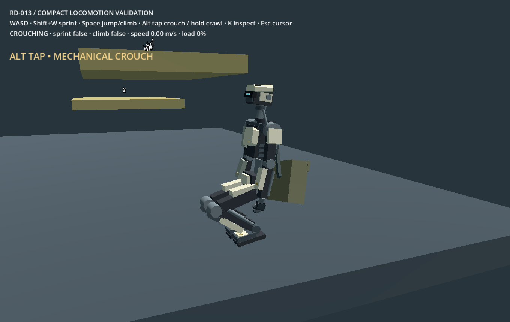
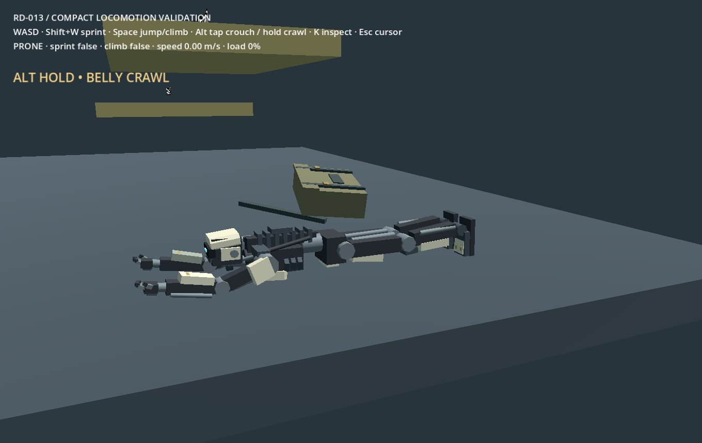
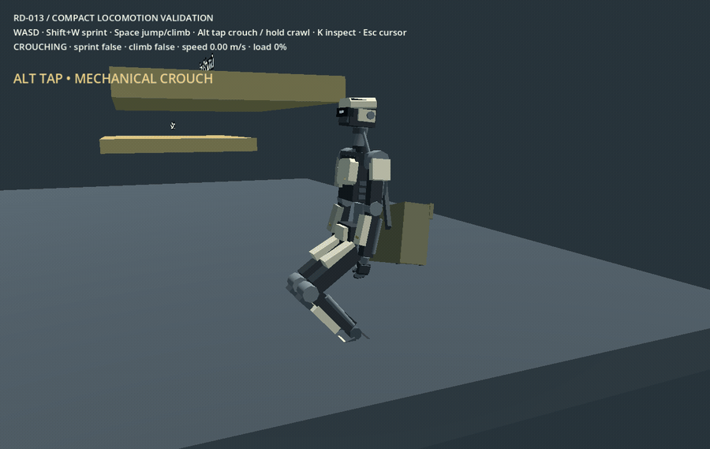
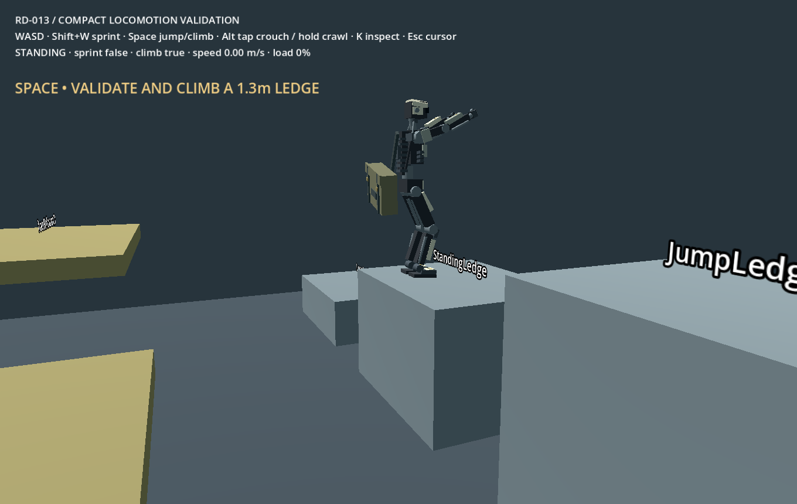
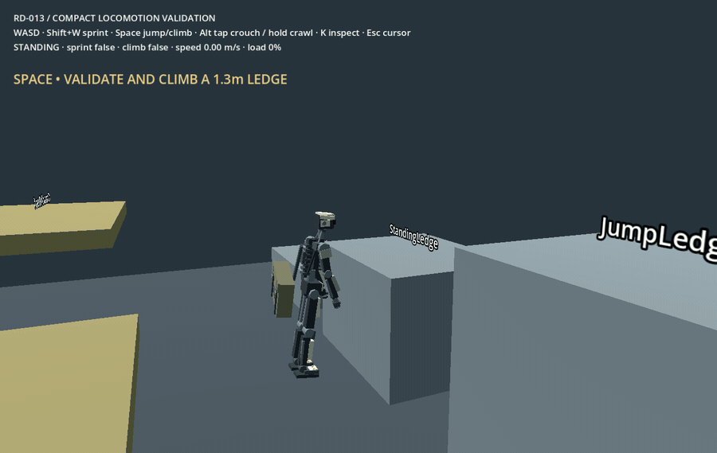
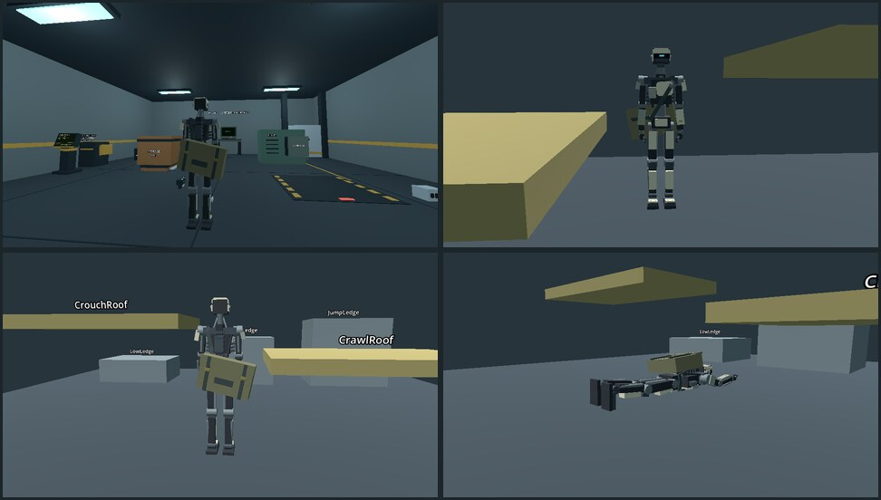
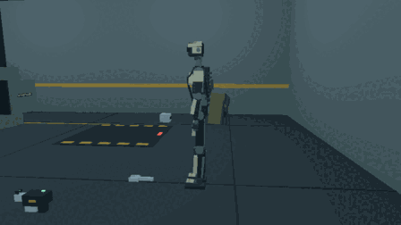
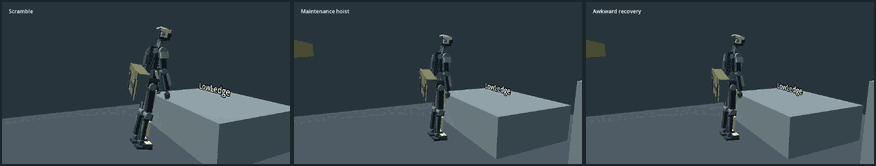

# RD-013 — Expanded Locomotion & Basic Traversal

Otis gains sprinting, jumping, crouching, belly crawling and ordinary ledge traversal. The ICF-01 Wayfarer uses its existing meshes, proportions, modules, hands and colors. The satchel sits closer to the torso, with a strap routed over the left shoulder and across the chest. Existing standing-forward gait amplitudes and distance-driven phase remain the reference; the same joints articulate other movement states.

## Controls

| Input | Behavior |
| --- | --- |
| W/A/S/D | Walk in the facing frame, with normalized diagonals |
| Hold Shift + W | Sprint; releasing either key ends sprint |
| Space, grounded | Attempt a reachable ledge, otherwise jump |
| Space, airborne | Catch and climb a reachable ledge; no double jump |
| Tap Alt | Stand ↔ crouch; crawl → crouch |
| Hold Alt for 0.4 s | Enter belly crawl; release does not also toggle crouch |
| C | Switch between first person and the right-shoulder gameplay view |
| K | Enter screenshot orbit or return to the previous gameplay camera |
| Hold Q/E, orbit only | Rotate the screenshot camera left/right |
| Horizontal wheel tilt, orbit only | Rotate the screenshot camera in steps |
| Escape | Existing cursor/menu/placement behavior |

The named runtime InputMap actions are `locomotion_sprint`, `locomotion_jump` and `locomotion_posture`. Defaults are physical Shift, Space and Alt. They register only if absent, preserving future remapping. The camera actions are `camera_gameplay`, `camera_orbit`, `camera_orbit_left` and `camera_orbit_right`. C is ignored during orbit. Q/E take priority over context and socket installation in orbit. Movement, posture, jumping, climbing and vertical wheel controls continue to work.

Sprint requires forward input and standing posture, and is disabled during precision manipulation, ADS and climbing. Prone and supported heavy dragging reject jumps. A crouched jump first requires standing clearance. Menus, inventory, terminals and cursor release clear pending jump/Alt gestures and horizontal movement. Inventory can interrupt a climb; normal gravity resumes from the last valid pose.

## Initial tuning

`data/locomotion/wayfarer_movement.tres` exposes `LocomotionTuning` in Godot's Inspector. Chassis attributes still supply the base walking speed, acceleration and lift rating, including their existing manufacturing variance.

| Parameter | Default |
| --- | --- |
| Base walk / acceleration | Existing chassis values; nominal 4 m/s / 18 m/s² |
| Sprint | 1.6 × base speed before load modifier |
| Crouch / crawl | 0.6 / 0.3 × load-adjusted walking speed |
| Unloaded jump height | 0.75 m |
| Alt hold | 0.4 s |
| Standing collider | Capsule, 1.8 m high, 0.3 m radius |
| Crouch collider | Capsule, 1.4 m high, 0.3 m radius |
| Prone collider | Horizontal box, 0.96 m wide × 0.84 m high × 2.3 m long |
| Eye heights | Standing 1.65 m / crouch 1.25 m / prone 0.35 m |
| Ledge face reach | 0.85 m |
| Ledge top rise above current feet | 0.25–1.35 m |
| Nominal climb durations | Scramble 0.79 s / Maintenance Hoist 0.85 s / Awkward Recovery 0.82 s |

These are provisional gameplay values. The conservative prone footprint includes the outstretched hands and existing satchel on Otis's back. Entering it requires room in front and behind. Every posture checks the actual candidate shape against world geometry before switching. Feet retain the same character origin. Prone yaw checks bounded intermediate orientations so a long footprint cannot freely rotate through a nearby wall. Camera interpolation includes a world-geometry clamp near low ceilings.





## Load policy

`LocomotionLoad` is independent of the body controller. It samples the actor's existing `carrying_loads().total`, divided by the current chassis lift capacity. Inventory, equipped items and distinct suspended objects count once; owned equipment in precision placement is already equipped mass. Supported pushing/dragging adds no carried mass.

| Carried fraction | Jump-height factor | Sprint-speed factor |
| --- | --- | --- |
| 0% | 1.00 | 1.00 |
| 25% | 0.85 | 0.95 |
| 50% | 0.65 | 0.85 |
| 70% | 0.45 | 0.75 |
| 100% | 0.20 | 0.55 |

The five jump/sprint factors are editable arrays on the tuning Resource, with piecewise-linear interpolation. Walking loses up to 25% and acceleration up to 30% at the current lift rating. Temporary overload applies a bounded additional reduction. Jump takeoff uses `sqrt(2 * gravity * adjusted_height)` and ordinary CharacterBody3D gravity/collision produces the arc. Chassis values are never permanently changed.

## Ledge validation and movement

A forward face query, downward top query and five support samples find a nearly level, supported destination. The standing collision profile must fit there. Whole-body physics sweeps validate the vertical clearance and forward route before a climb starts. The top must be stationary or nearly stationary; moving geometry is not frozen for the player.

Traversal uses two short collision-checked CharacterBody3D movements: raise clear of the face, then move onto the top. No collision body is disabled and no transform teleport drives the arc. The support is checked during traversal. New path obstruction or support motion aborts at the last safe pose and restores ordinary gravity. Space during a real jump can start the same validated climb from an elevated feet position.




## Integration and animation

`OtisController` retains camera aiming, equipment and object targeting and delegates movement to `OtisLocomotion`. Separate tuning and load functions permit later capability modifiers without altering ownership or physics APIs. Interaction menus and tools use the existing input ownership; construction actions are suppressed during an active climb.

The procedural rig preserves the forward walk, reverses stride for backward motion, adds lateral leg articulation, speeds its distance-driven cycle during sprint, and folds existing joints for crouch/crawl/climb. Prone head articulation keeps the optic looking forward. The inventory preview deliberately resets to its neutral equipment mannequin, including its head, while the live actor retains the current posture. No meshes, sockets or materials were redesigned.

## Contact pushing and camera collision

Grounded movement applies a bounded horizontal impulse to a contacted loose body, with one traction budget per physics tick. Rigid-body friction and mass determine how far it moves. Dynamic fastened assemblies have one compounded collision root and contribute their total mass. Anchored or mounted items remain constrained. Stationary, sleeping loose items can move on contact. On slopes and in motion, the outcome depends on the contact direction and available traction.

The shoulder and orbit cameras sweep a small sphere from Otis toward the requested viewpoint. A wall retracts the camera immediately, and the camera eases outward once clear. In a tight space the chassis can briefly hide to keep it out of the near plane. Targeting, precision placement and tool operation still originate at Otis's eye.

## Compact development fixture

Normal F5 launch still uses the existing Facility. The optional fixture is a separate small primitive floor with three ledges and two low roofs, not a new Facility room or the Engineering Test Hall:

```bash
godot --path . res://scenes/locomotion_validation.tscn
```

Use Godot 4.7.2. LowLedge is 0.65 m, StandingLedge 1.3 m, JumpLedge 1.8 m. The crouch roof clears 1.5 m and the crawl roof 0.94 m. C shows the shoulder view. K enters orbit for inspecting the joint poses. Escape releases the cursor; left-click recaptures it.

## Playtest correction captures

Shoulder gameplay and front orbit are shown above the rear standing and crawling views. Captured in the Godot 4.7.2 Compatibility renderer.







## Verification and independent review

Run the complete verification script with `GODOT_BIN` pointing to Godot 4.7.2:

```bash
GODOT_BIN=/path/to/Godot_v4.7.2-stable_linux.x86_64 bash tests/validate.sh
```

The full RD-001–RD-013 suite includes focused checks for contact pushing, camera routing, climb variants and satchel attachment. Counts and hosted run results are recorded in the draft PR.

Godot's headless DisplayServer cannot retain mouse capture. Only in the headless test, an inherited test driver substitutes that capture gate; the real InputMap, character, shapes, gravity, sweeps and object transfers remain in use. The graphical run exercises the unmodified gameplay class. The test adapter is never installed by gameplay code.

Coverage includes hold-to-sprint cancellation, both jump arcs and loading, no double jump, real Alt input/hold discrimination, crouch and prone clearance, bounded prone turning, valid and airborne ledges, mid-path obstruction, support movement, actual equipped/stored mass, no duplicate precision mass, supported-drag exclusion, tools/ADS, inventory/terminal cleanup, interrupted climbing and neutral preview presentation. Existing RD-001–RD-012 suites retain machinery, fastening, satchel, equipment and knowledge coverage. `project.godot` is checked for stability.

Independent review caught posture/visual mismatch, prone head direction and headless input assumptions. Corrections preserve the meshes and use matched profiles, posture-relative head articulation and the isolated headless test gate. Independent X11 adversarial tests also checked interrupted paths, changed support, prone rotation and stale gestures. Final review findings and the successful candidate SHA are recorded in the draft PR.

## Manual acceptance

1. In the Facility, hold Shift+W, release Shift, then release W separately. Check acceleration, stopping and diagonal/backward/strafe motion. K shows the approved gait family.
2. Jump in clear space and land. Press Space again while airborne without a ledge: no second jump. Repeat with carried inventory/tools and compare height/speed.
3. Tap Alt, hold Alt, and tap back through crawl → crouch → stand. Try to rise beneath each low roof. Turn while prone beside a wall; the longer body must remain clear.
4. Space near LowLedge/StandingLedge. At JumpLedge, jump first and press Space again near its top. Try blocked headroom, missing support and a moved obstacle.
5. Open inventory during movement/climb, close it and resume. Open it prone and check neutral equipment presentation. Verify terminal ownership and cursor/focus cleanup.
6. Recheck Uni-Bolt aiming, free rotation, pickup, carrying, precision placement, heavy dragging, physical satchel, pressure plate, barrier and hydraulic controls in the normal Facility.

## Limits

This is basic traversal with simple joint poses, not parkour or foot-locking/IK. Transitions and tool-arm presentation may need further Ubuntu playtest tuning. The prone box intentionally reserves the full satchel/reach envelope. Climb support is geometric and nearly stationary, without a new material-strength or dynamic moving-platform climbing model. Ledges need a broad, nearly level top and a clear vertical-then-forward path. There is no automatic stair step, ladder, wall jump, stamina, procedural traversal or new Facility room.
