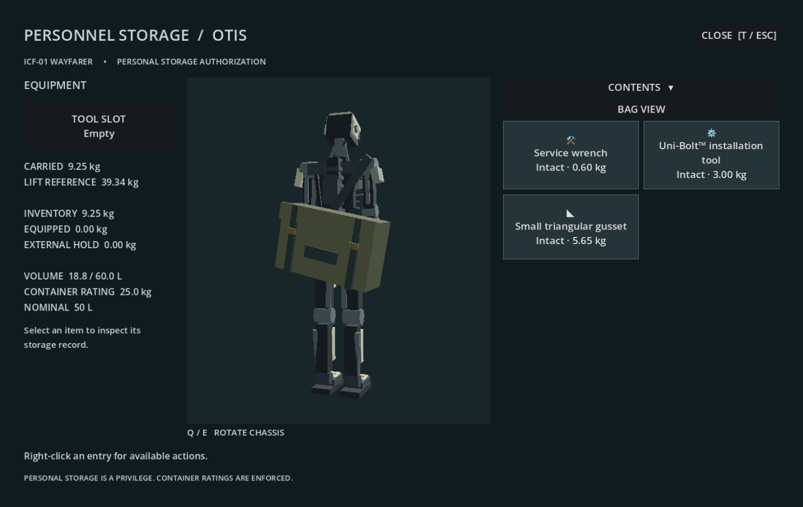
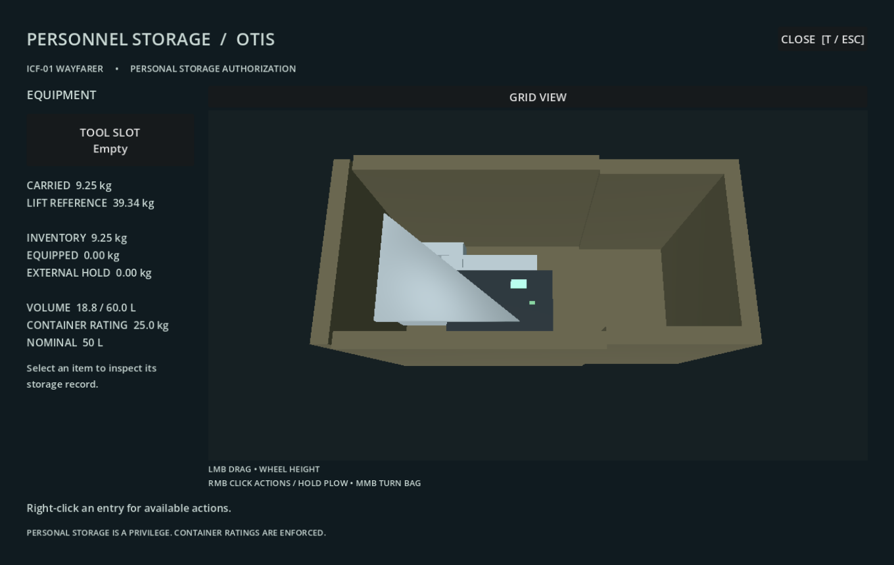
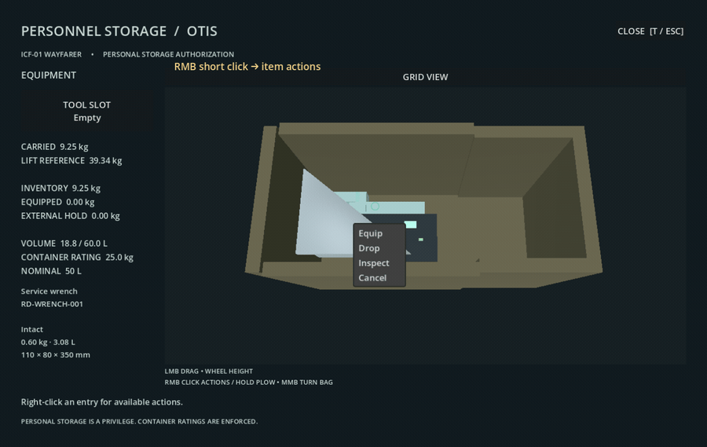
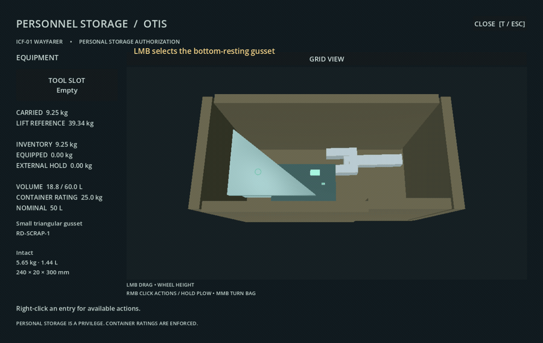
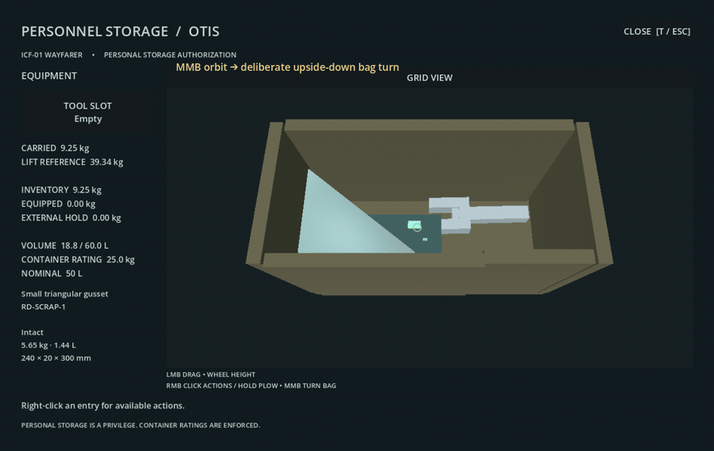
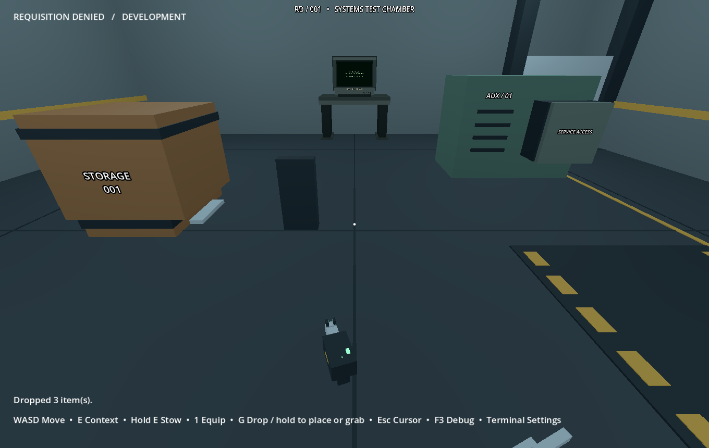

# Physical satchel

Otis's messenger satchel reads authoritative inventory fullness without changing the approved chassis, gait or collision body. Its lower, diagonal attachment and shoulder strap are cosmetic. Adjust the six attachment parameters in [`satchel_tuning.tres`](../../data/inventory/satchel_tuning.tres) through Godot's Inspector; the checked-in resource supplies the defaults. The same resource centralizes gesture thresholds, vertical steps and inversion safeguards.

## Controls

Open **T**, then choose **Bag View / Grid View**. Bag View temporarily borrows the character-preview column. Grid View restores the preview; **Q/E** retains preview rotation.

| Input inside Bag View | Behavior |
| --- | --- |
| LMB | Select an item |
| Hold LMB + move | Physically drag it across the selected interaction plane |
| Wheel down / up | Raise / lower the selected item's target in configurable 8 cm increments |
| RMB click | Applicable Equip, Drop, Inspect and Cancel actions |
| RMB hold + move | Plow after both 0.18 s and 6 pixels of movement |
| MMB + move | Orbit; continue a deliberate vertical turn to invert the bag |

The wheel never zooms. Without selection it does nothing. LMB dragging or wheel movement acquires a physical hold; releasing LMB retains its target height. Resume dragging to rearrange it horizontally at that height. Click empty bag space to release it to gravity. Dragging uses bounded impulses, gravity compensation and a maximum target-following speed of 0.45 m/s; existing item and container collisions remain authoritative. The on-screen hint distinguishes selected, held, returning and ready-to-drop states.

RMB release ends Plow Mode immediately and cannot also open a context menu after the plow consumed the gesture. Releasing outside the view, closing inventory or losing focus cancels the gesture. Gameplay RMB aiming and Grid View actions retain their meanings.

## Shared ownership and item actions

Bag and Grid actions call the same equipment controller. Equip supports the existing transactional slot swap; an unstoreable displaced item rejects the swap. Inspect displays identity, condition, mass, dimensions and relevant metadata without transferring ownership. The original object retains ammunition and mutable state.

InventoryItem retains the real object. ContainerInterior creates temporary RigidBody3D representations from its actual collision shapes, meshes and mass. It adds no authoritative InteractableObject, tool logic or ammunition. BagView owns a separate World3D only while inspected. Closing captures packing transforms and destroys that simulation. The existing version-1 manifest retains `internal_pose` and the optional `packed` flag; legacy records initialize through the same packing stage. Unsafe legacy arrangements remain available through Grid View with feedback.

The character preview now poses its visual copy from current equipment ownership on every refresh. Unequipping immediately restores its neutral arm and corrected wrist. Equipped wrist flexion is bounded; tool presentation compensates its transform to preserve existing head-oriented aiming. Chassis geometry, chirality, walking animation and head synchronization are unchanged.

## Inversion and natural world drops

Ordinary horizontal orbit does not dump. Vertical MMB movement first adjusts inspection angle, then visibly turns the bag about its center. Holding its opening at least **155° from up for 0.35 seconds** initiates dumping. Releasing an incomplete turn returns it upright. Bag proxies pause during the turn; this is a presentation transition rather than continuous gravity simulation across worlds.

The short visual sequence closes inventory and calls a coordinated equipment-controller batch. Individual Drop and batch dumping share full-shape forward-arc release searches: varied angular/radial positions roughly 0.7–1.75 m ahead, accessible surfaces, collision-safe paths, same-frame pose reservations and staggered releases. World physics settles the actual objects. Normal gameplay **G** dropping retains its existing aimed placement behavior.

Failed releases remain stored. Partial dumps report released and retained counts, preserve identities and update fullness from actual inventory. Dumping locks competing transfers and UI close/view changes until the visual handoff completes. Reopening cannot reuse an old inversion angle.

## Taking an item through the opening

Lift an item until its entire collision volume clears the top by **25 mm**. Its cursor and status show **READY TO DROP**. Release an active LMB drag, or click empty space, to use the same transactional world Drop as the context menu. Boundary crossing alone never transfers ownership. A failed world placement reports the rejection and retains the original item safely in storage.

Only the held proxy bypasses its containment lid. Side walls and other items remain solid. Cancelling a partial exit returns the item through the opening using the same bounded physical controller, then restores its lid. Re-selecting resumes from its current height. Closing the interface cancels the temporary preview without saving a fully extracted packing pose. Inversion waits for an unfinished partial exit to return; its threshold and dwell remain unchanged.

The general proxy setup keeps four reported contacts, preserving Jolt's compound support manifolds for thin hollow stock without monitor signals. Tubes retain their original outer/inner dimensions and hollow collision geometry. See [the floor-contact investigation, controls and extraction report](physical-bag-controls.md).

## Capacity and bounded expansion

| Configuration | Value |
| --- | --- |
| Nominal capacity | 50 L |
| Maximum expanded capacity | 60 L |
| Independent structural rating | 25 kg |
| Base envelope | 64 × 40 × 26 cm |
| Maximum packing/collision envelope | 68 × 42 × 28 cm |
| Initial packing orientations | Six axis permutations |
| Search bound per new item | 4,096 poses |

The maximum envelope reserves the expansion allowance in advance. Admission, physical packing, containment and display use that same envelope; the volume limit remains 60 L. This is bounded expansion with rigid collision walls, rather than continuous cloth deformation. Six visible pleats, three on each long face, respond modestly to nearby contents. Their displacement is bounded to about 8 mm. The external shell becomes more distended through empty, partial, full and bulging states; the UI labels storage above 50 L as expanded.

Admission applies effective volume, structural mass, dimensions and actual packing clearance. New placements are staged before committing a transfer. Existing safe poses remain unchanged; swaps exclude the outgoing item while testing admission. Actual object dimensions and mass are retained. RD-011's aggregate bounding-volume estimate remains conservative, especially for hollow or angle stock.

## Verification and independent review

`GODOT_BIN=/path/to/Godot_v4.7.2-stable_linux.x86_64 bash tests/validate.sh` runs the complete RD-001–RD-012 suite, including 38 shared world-drop checks, 40 playtest-correction checks, 111 round-stock checks and 75 opening/control checks. The full suite contains **1,631 checks**, plus fresh editor import and main-scene smoke runs. The configuration test verifies Jolt and Compatibility rendering and checks `project.godot` normalization.

Coverage includes click/hold discrimination, direct equipment and preserved ammunition, preview reset, generated-gusset lifting and settling, persistent wheel holds, bounded pleats, inversion dwell, batch/partial failures, identity preservation, reopening during a partial turn, 57.6 L physical packing, and rejection above 60 L. Existing suites cover safe equipment swapping, structural groups, heavy dragging, hollow stock, aim-to-hold and dispenser occupancy. Obsolete authored scrap fixtures were removed; structural tests now dispense catalog stock, including the triangular gusset.

Independent review found stale inversion state on reopening, empty-bag restoration and UI changes interrupting the dump tween. These were corrected and covered. Investigation also found an unconditional parent transform reset cancelling physical drag impulses; upright restoration now writes a transform only when needed. Final independent review reported no remaining blockers.

Graphical captures use the real Godot 4.7.2 Compatibility renderer with software OpenGL on Linux. They exercise mouse events and actual proxy physics. They are reproducible demonstrations, not a hardware responsiveness benchmark or a substitute for the user's Ubuntu playtest.

## Manual acceptance

1. Dispense a gusset, flat bar and other small stock; store them with a wrench and Uni-Bolt. Open T and rotate the preview to inspect the slung satchel.
2. Select Bag View. Short RMB-click an item; Inspect it, Equip directly, and verify current tool state. Unequip through the equipment slot; check the neutral preview in Grid View.
3. Hold RMB and move; release and verify no context menu. LMB-drag a floor-resting gusset and use the wheel down to lift it, release LMB to hold, then click empty space to settle. Repeat with stacked tools and buried stock.
4. MMB orbit horizontally, then return. Continue a deliberate vertical turn past inversion and wait for the dump. Check the loose world pile, identities, ammunition and bag fullness. Repeat near blocked geometry; failures must remain stored with feedback.
5. Close during a partial turn and reopen; confirm upright contents and normal manipulation. Close inventory and verify movement, ADS, precision placement and aim-to-hold.
6. Check expanded volume and the independent 25 kg rating, delivery-pad occupancy, hydraulic loading and structural separation.

Packing is a bounded conservative search. Hidden items can require rummaging or a different viewpoint for selection. Pleats and shell expansion are visual, using a fixed maximum collision envelope. Inversion is an abstracted batch transfer. Crowded world geometry can retain some items. Full cloth, exhaustive nesting and world save/load remain outside scope.

## Round-stock playtest correction

The final round-stock correction replaces inflated rotated bounds with actual shape-support bounds and makes the defensive containment guard compatible with Jolt's resting-contact tolerance. Bag controls, dimensions, 50/60 L capacity, 25 kg rating, pleats and inversion settings are preserved. See [the controlled reproduction, focused tests and graphical demonstration](round-stock-correction.md).
