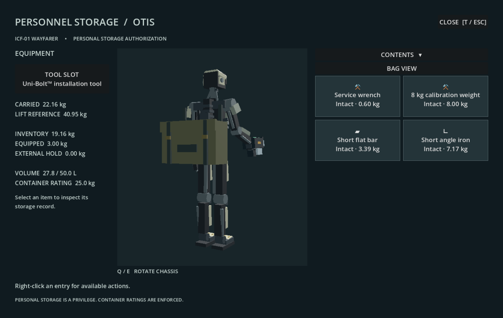
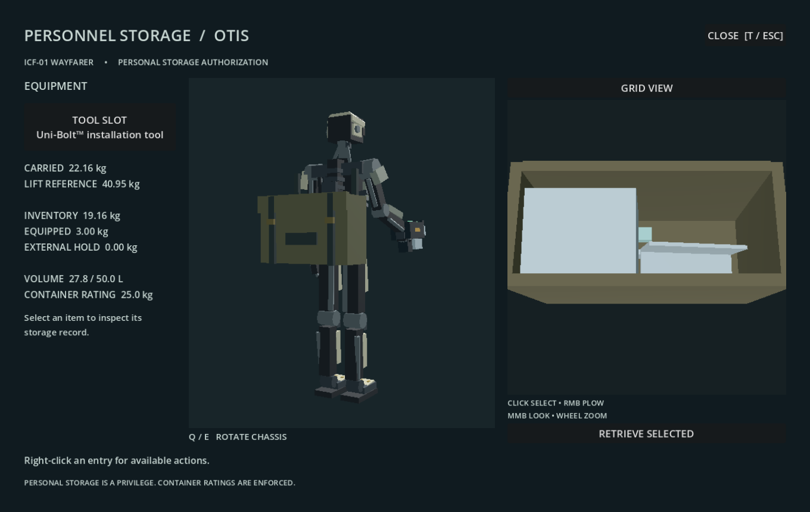
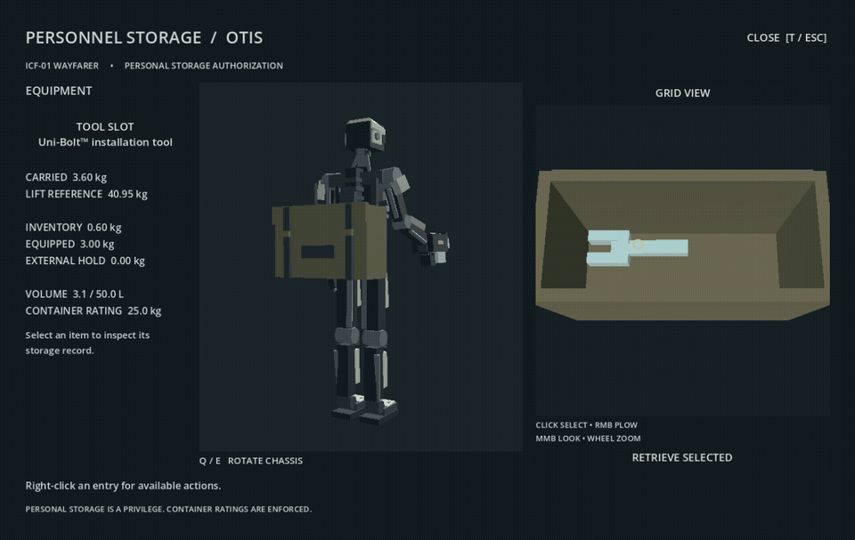

# Physical satchel

Otis's industrial satchel attaches to the existing rear equipment mount. Its shell eases between empty, partial, full and bulging shapes based on authoritative container volume. It adds no gameplay collision bodies and uses the approved chassis animation.

## Controls

Open inventory with **T** and switch using **Bag View / Grid View**. Click a physical item to select it. The identity and properties appear in the inventory details. **Retrieve Selected** uses the same transfer operation and world-clearance checks as the grid. An equipped tool is excluded from bag retrieval.

Hold **RMB** inside Bag View and move the cursor to push contents. Releasing RMB, leaving the view, closing inventory or losing focus stops the plow. The small cursor ring changes colour during plowing. Grid right-click actions and normal gameplay RMB aiming retain their meanings.

Middle-mouse drag changes the bag viewpoint. The wheel adjusts its camera's field of view. **Q/E** continues to rotate the character preview. Normal cursor movement highlights and selects without applying forces.

## One set of records

InventoryItem retains the real object and its gameplay state. The isolated ContainerInterior creates temporary RigidBody3D representations using those objects' existing collision shapes, mesh geometry and mass. It adds no copies of the authoritative InteractableObject, tool logic or ammunition.

BagView creates a SubViewport with its own World3D only while inspected. On close, it saves the rigid-body transforms to each record, removes the viewport and releases the temporary physics world. The physical arrangement remains in the existing version-1 manifest through internal_pose plus an optional packed flag. Old records missing that flag initialize through the same packing stage. If a legacy arrangement cannot be made safely, items remain owned and available through the grid with a clear message.

A ContainerDefinition can enable physical_packing and supply a compatible ContainerInterior scene. The initial satchel uses the default procedural interior. Other container kinds can reuse this contract and replace the shell later.

## Capacity and packing

| Configuration | Value |
| --- | --- |
| Effective capacity | 50 L |
| Independent structural rating | 25 kg |
| Internal envelope | 64 × 40 × 26 cm |
| Envelope volume | 66.56 L |
| Effective-volume fraction | About 75% of the envelope |
| Initial packing orientations | Six axis permutations |
| Placement search | At most 4,096 candidate poses per new item |

The envelope leaves room for loose packing around the nominal 50 L payload. Items retain their world dimensions and scale. RD-011's aggregate bounding-volume estimate remains intentionally conservative, especially for angle stock and hollow tubing. The capacity increase is implemented through container configuration, without shrinking contents or changing mass.

Admission first applies volume, structural mass and sorted dimensions. The bounded physical packing stage then checks actual collision geometry for existing arrangements and uses conservative bounding boxes for new placements. Existing valid poses survive unchanged. New poses are staged before storage commits. Equipment swaps test packing after excluding the outgoing stored item.

Packing queries use a temporary physics space that is freed before returning. There is no continuous closed-bag simulation. More elaborate shape nesting or exhaustive packing is outside this revision. A cluttered bag may reject a physically possible placement when the bounded search cannot find it.

## Physics and containment

The interior uses a rigid floor, side boundaries and an invisible containment lid. Rendered fabric walls can move outward by up to 7 mm near contents, then recover. Those visual offsets never move the collision boundaries.

Plow movement uses a swept sphere capped at 0.45 m/s, an additional 6 mm contact-assistance envelope and bounded impulses. Top contacts produce tangential pushes rather than increasing the load against the floor. Actual item rotation and object-to-object contact remain Godot physics. Speed limits preserve newly submitted impulses. A defensive containment check restores the last in-bounds transform only if a proxy escapes beyond the small contact tolerance.

The plow can reach the top of a nearly full bag while the item containment lid remains solid. This is a virtual inspection tool. It does not transfer force into the Facility or change Otis's lift limits.

## Verification and review

Run tests/validate.sh with GODOT_BIN set to Godot 4.7.2. The satchel suite covers packing rollback, shared identities, persisted transforms, legacy records, selection, mouse-event plowing/release, equipment, repeated inspection and near-full containment.

A 40-object load occupies about 46 L. It passed 90 physics frames without escape, then released its simulation on close. That test took about 1.5 seconds at the normal 60 Hz headless cadence, including those frames. This is a stability observation, rather than a hardware performance benchmark. No arbitrary inventory item-count limit is introduced.

Independent review caught an initial top-contact gap, a velocity clamp that erased new impulses, asymmetric containment tolerance, inaccessible-container inspection and a bag-retrieval selection guard. These were corrected. The primary implementer reviewed the delegated velocity correction and verified the mouse-event and graphical tests.

The GitHub Actions workflow runs the complete headless suite and verifies that project.godot stays unchanged.

## Manual acceptance

1. Store a wrench and several small pieces of scrap, equip Uni-Bolt and open T. Rotate the preview to inspect the satchel.
2. Switch to Bag View. Hover and select items. Drag while holding RMB, then release and select normally.
3. Use middle-mouse drag and the wheel to inspect around a larger object. Verify that the selected item's identity matches the grid.
4. Leave Bag View and reopen it. Confirm that the arrangement persists. Close inventory and check ordinary movement and aiming.
5. Retrieve an item from Bag View, then repeat with blocked world clearance. A failed retrieval must retain the same stored item.
6. Equip and unequip through the grid, add items until either mass, effective volume or physical placement is rejected, and verify the rejection preserves ownership.
7. Recheck precision placement, heavy dragging, the hydraulic ram, structural failures and Uni-Bolt aim-to-hold stabilization.

Packing remains conservative. Individual objects cannot yet be lifted by the cursor or dumped from the bag. The shell deforms visually using rigid panels, rather than cloth. Items below other items may need rummaging or a different view angle for selection. World save/load remains outside scope.
