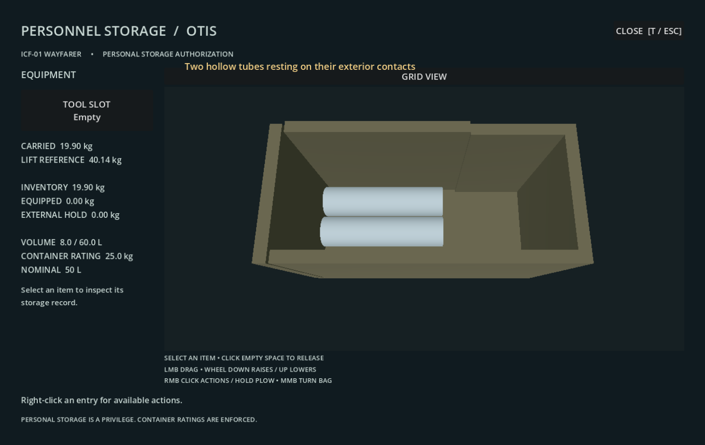
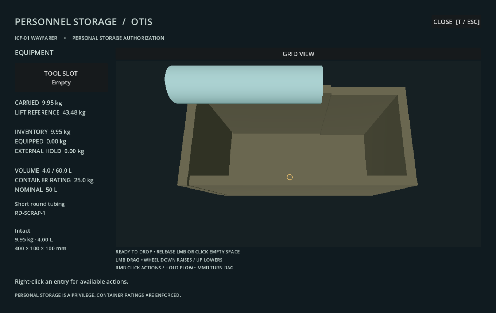

# Tube contacts and physical bag controls

This final RD-012 correction preserves the messenger attachment, camera, pleats, 50/60 L capacity, 25 kg rating, Grid View, equipment transfers and deliberate 155°/0.35 s inversion gesture.

## Confirmed tube-floor cause

Generated tubing uses a 50 mm outer radius, 38 mm inner radius and twelve hollow convex strips. Its visual mesh and shape transforms use the correct exterior dimensions. Node and PhysicsServer transforms agree. The reported penetration was real physical settling, not an inner-diameter substitution or a visual transform offset.

Godot 4.7.2's Jolt integration enables manifold reduction for bodies that report no contacts. With the default zero reported contacts, the tube's thin compound support manifolds could reduce away, allowing it to settle into Jolt's 20 mm contact slop. Zero shape margins and contact monitoring alone did not fix it.

| Actual Jolt probe | Default proxy | Four reported contacts |
| --- | --- | --- |
| Corner-packed tube | −19.89 mm | Approximately 0 mm |
| Centered tube | −20.00 mm | Approximately 0 mm |
| Tube dropped from height | −20.00 mm | Approximately 0 mm |
| Rolled tube | −12.90 mm | −0.079 mm |
| Two independently dropped tubes | — | Both approximately 0 mm |

The general temporary proxy now sets `max_contacts_reported = 4` before entering the physics world. No contact monitor or per-frame logging is enabled. This preserves its compound contact manifolds while retaining stock geometry, friction, forces, sleeping and world-object physics. The coupling is explicit in [Godot's Jolt body implementation](https://github.com/godotengine/godot/blob/4.7.2-stable/modules/jolt_physics/objects/jolt_body_3d.cpp#L809).

## Current interaction model

| Action | Result |
| --- | --- |
| LMB on an item | Select and acquire its physical target |
| Hold LMB + move | Drag horizontally at the target height |
| Wheel down / backward | Raise by 8 cm per step |
| Wheel up / forward | Lower by 8 cm per step |
| Release LMB inside the bag | Keep the physical target held |
| Click empty bag space | Release to gravity, or confirm a clear extraction |
| Release LMB after fully clearing the opening | Request safe world Drop |
| RMB click / hold+move | Existing context actions / Plow Mode |
| MMB drag | Existing orbit and deliberate inversion |

`SatchelTuning.height_step` centralizes the doubled sensitivity. The target remains active after pointer release. A resumed drag keeps its established height. Held proxies remain dynamic, collidable and force-limited; they are not frozen or directly teleported. The status line distinguishes selected, held, returning and ready-to-drop states.

## Opening extraction and cancellation

`ContainerInterior.can_extract()` checks the actual occupied collider bounds, not the camera target or center. The entire item must be above the rim plus the configurable 25 mm exit clearance, with its lateral bounds inside the opening. Minor rim overlap cannot trigger a transfer. Crossing that boundary without a deliberate release leaves ownership unchanged.

The held proxy temporarily excludes only its invisible lid. Physical side walls, other contents and every other proxy's lid remain active. On a partial cancellation, the same bounded controller returns the item through the opening before restoring its lid. Its target clearance is recalculated as it rotates. Re-selecting during return latches its current position and resumes holding.

A completed extraction calls `InventoryScreen.perform_action(2)` and the existing equipment `retrieve()` transaction, exactly as context-menu Drop does. The forward-arc world search checks actual geometry. Obstruction retains the original inventory item and state, reports the rejection and reopens it inside safe packing. There is no second ownership or transfer implementation.

Closing or switching views cancels the ephemeral hold. Fully extracted poses are not written to inventory packing metadata or the ordinary escape-recovery cache. Shallow contact tolerance can still be cached; conservative admission revalidates it on reopening. A partially extracted item returns before a vertical bag turn begins; normal inversion effort is unchanged.

## Changes and verification

Production changes are limited to:

- `scripts/inventory/container_interior.gd`: support contacts, held-lid exception, bounded opening/return states and safe capture.
- `scripts/inventory/bag_view.gd`: persistent pointer/hold separation, reversed wheel mapping, feedback and extraction request.
- `scripts/inventory/inventory_screen.gd`: feedback and routing through shared Drop.
- `scripts/inventory/satchel_tuning.gd` and `data/inventory/satchel_tuning.tres`: 8 cm height steps and 25 mm exit clearance.

`tests/validate_bag_opening.gd` supplies **75 focused real-physics checks**. It covers correct exterior and rendered resting height, an open bore, dropped/rolled/paired tube contacts, item collisions, actual mouse dragging, wheel directions, persistent height, explicit release, whole-boundary checks, rotated return/reselection, real obstructing world geometry, identity/ammunition, close/reopen, context Drop and unchanged capacities/inversion. Earlier satchel and round-stock tests now assert the requested persistent controls.

The complete RD-001–RD-012 suite contains **1,631 checks**. Graphical verification runs the 75 new checks and 111 round-stock checks with actual Jolt bodies under the Linux Compatibility renderer. Screenshots and the demo use real Bag View input. Final results, independent review and the exact successful GitHub Actions candidate are recorded in PR #12. `project.godot` is unchanged.

Independent review identified that a returning part's rotation could change its clearance and that reselecting should latch its current pose. Both are corrected and tested. The reviewer independently rotated a tool during its physical return and verified it returned inside with its lid restored.

## Manual acceptance

1. Dispense/store one short round tube, then two. Inspect their floor contact and bore. LMB-drag, wheel down to raise, then wheel up to lower. Repeat after settling and reopening.
2. Release LMB and verify the item remains suspended. Resume horizontal dragging without a height jump. Click empty space to release and check natural settling.
3. Lift an item fully beyond the rim. Verify READY TO DROP appears only after its whole volume clears. Release LMB and inspect the original world object, condition and ammunition.
4. Repeat with blocked world clearance. The failed transfer must retain the item. Clear the obstruction and retry.
5. Cancel while partly above the rim, then resume while returning. Close/reopen during extraction; no duplicate or outside packing record may remain.
6. Repeat with wrench, Uni-Bolt, rod, flat stock and mixed contents. Recheck RMB Drop, Plow Mode, MMB orbit and deliberate inversion dumping, equipment swaps and gameplay interactions.

## Limits

The smooth tube mesh and its twelve collision wedges retain a small faceting difference, up to approximately 1.7 mm at intermediate roll angles. This correction removes the demonstrated 20 mm floor sinking without changing approved world stock geometry. Hidden items can still require rummaging; real obstructions can prevent a particular movement or return until repositioned. Closing revalidates conservative packing and can reposition an arrangement. Failed world releases remain stored. No deferred belt, wrench, locomotion or world-building features are included.
