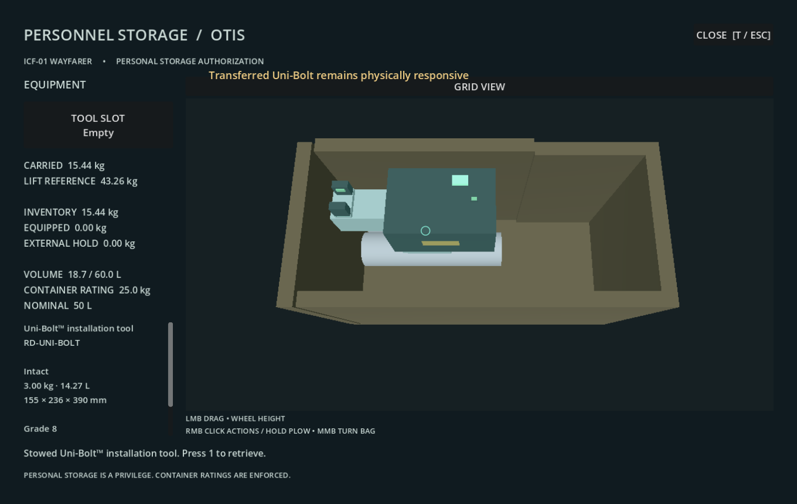
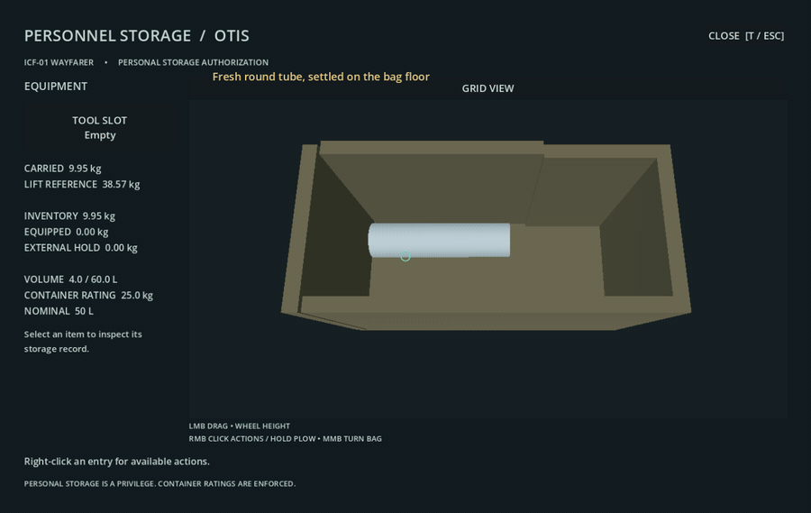

# Round-stock manipulation correction

The round-stock playtest exposed a shared containment defect. It did not require changing stock friction, equipment transfers, sleeping policy, controls, bag dimensions or inversion behavior.

## Controlled reproduction

Fresh Facility instances and dispenser-generated stock were used. Selection, motion, sleep/freeze state and temporary containment-reset counters were observed independently.

| Case | Before correction | After correction |
| --- | --- | --- |
| A: single solid rod | Initial axis-aligned rod moved; rolled/contacted rods could later stick | Horizontal mouse dragging, wheel lifting, release, sleep/wake and remanipulation pass |
| B: single hollow tube | Selection succeeded, but zero displacement over 90 drag frames; 207 containment resets, then 277 after another 70 lifting frames | Same original tube moves and lifts; real mouse-event regression passes |
| C: Uni-Bolt alone, unequipped into storage | Manipulated successfully, including after reopening | Remains functional; original slot, identity and ammunition state preserved |
| D: rod + tube + unequipped Uni-Bolt | Contacted tool could stay fixed despite successful selection; another 90 frames produced no displacement | Tool and both round pieces remain physically responsive |
| E: flat bar + gusset + rod + tube + tool | Reset loop could affect several contacted shapes | Top-first rummaging moves all five; connected ownership and containment remain correct |

In the matched before/after probe, the previously fixed tube moved approximately 9 cm in X and 10 cm upward after correction. The previously fixed mixed-stock Uni-Bolt also moved approximately 9 cm in X and 10 cm upward. Not every center ray in a mixed pile hits the intended part: another item can genuinely occlude it. Single-stock selection tests raycast actual geometry; mixed-contact physics tests explicitly retain each original item-to-proxy mapping.

## Confirmed root cause

`ContainerPacking.bounds()` rotated an already merged local axis-aligned bounding box. That box contains space not occupied by a round cylinder, convex hull or compound tool. After rolling or tilting, imaginary box corners could extend through the floor or walls even when the actual collider remained supported.

A separate tolerance mismatch could trigger the same loop even without rotation. The containment escape guard accepted only 4 mm of deviation, while the active Jolt solver's configured penetration slop is 20 mm. The tube repeatedly reached about 4.313 mm below the nominal floor plane during integration. Each guard recovery restored its cached transform and zeroed velocity after drag/plow impulses had been submitted. Those impulses never affected the next physics step.

The tool-alone comparison rules out equipment-to-storage initialization as the cause of this reproduction. Proxies were dynamic, correctly mapped, correctly shaped and awake during the failed mixed-stock attempts. `begin_drag()` already wakes deliberate selections; global sleeping remains enabled. Temporary reset instrumentation was removed after diagnosis.

## Minimal general correction

- `container_packing.gd` composes the complete object/shape transform before calculating occupied bounds. Boxes use transformed extents, cylinders use analytic support extents, spheres/capsules use their curved support, and convex stock uses actual transformed vertices. Unsupported shapes retain a conservative fallback. Compound bodies merge the resulting per-shape bounds.
- `container_interior.gd` keeps the defensive escape guard but accounts for active Jolt contact slop. Its tolerance is capped at 24 mm including the existing 4 mm margin. Solid boundaries, collision masks, CCD, speed limits, drag targets and forces are unchanged. A deliberate excursion beyond that tolerance still recovers in the regression test.
- Admission mass, nominal/expanded capacities and insertion dimensions are unchanged. Volume accounting remains conservative. There is no item-name handling.

The production correction affects those two shared files. `tests/validate_round_stock_bag.gd`, its UID and the validation runner add regression coverage; this document and the graphical evidence describe the result.

## Verification

The focused suite contains **97 checks** using real Godot 4.7.2/Jolt proxy bodies in the actual Bag View. It covers rod/tube collider dimensions and transforms, visible selection, horizontal mouse dragging, wheel lifting, sleeping and remanipulation, release and settling, true escape recovery, reachable Plow Mode, all five controlled scenarios, repeated reopening, ownership and Uni-Bolt ammunition.

The complete RD-001–RD-012 run includes **1,542 checks**. Graphical X11/Compatibility verification runs the same 97 focused checks. The existing suites retain inversion/dump, pleats, expansion, preview poses, equipment swapping, structural, hydraulic, terminal and dispenser protection. `project.godot` remains unchanged. Final results and the exact hosted candidate are recorded in PR #12.

The demo uses actual Bag View input and physics under Linux software OpenGL. It shows a freshly settled tube moving horizontally, lifting and settling, followed by a Uni-Bolt unequipped into rod/tube storage and lifted again.

## Manual acceptance

1. Empty the bag. Dispense/store a short rod. Let it settle, LMB-drag horizontally, wheel upward, release and repeat. Close/reopen and repeat after it sleeps.
2. Repeat with a short round tube. Check that its bore and compound collision geometry remain intact.
3. Equip Uni-Bolt, open T and unequip into an empty bag. Manipulate it, reopen and repeat.
4. Store rod and tube, then unequip Uni-Bolt into that bag. Manipulate all visible pieces, including after mutual contact. Check magazine and grade after re-equipping.
5. Add flat bar and gusset. Rummage covering pieces first, lift and release each part, then try RMB plowing from a clear approach. The plow must still reject a start through the bag wall.
6. Recheck approved orbit, wheel, context actions and deliberate inversion dumping. Threshold remains 155° with a 0.35-second dwell. Capacity remains 50 L nominal / 60 L expanded / 25 kg.

## Limitations and review

The guard permits the physics solver's shallow resting-contact tolerance; it does not enlarge physical walls or authorize deeper escapes. Conservative packing may reposition a settled arrangement on reopening if its stored pose falls outside the stricter admission tolerance. Covered items still require rummaging or another view angle, and actual collision constraints can prevent a particular requested direction. No object can be dragged through covering solids.

Independent review confirmed the before/after reset evidence, support-bound mathematics, unchanged ownership/capacity/forces and continued escape recovery. Final review findings and hosted verification are recorded in PR #12. The user's Ubuntu hardware playtest remains the final interaction-feel check.
