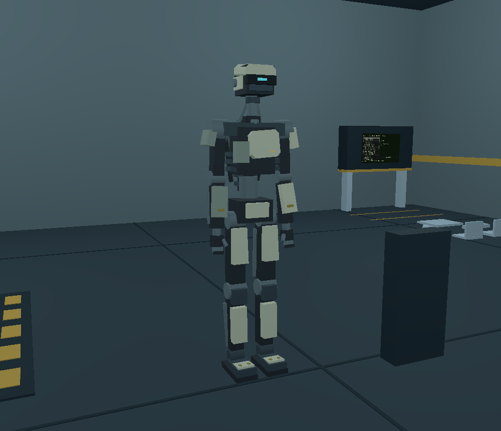
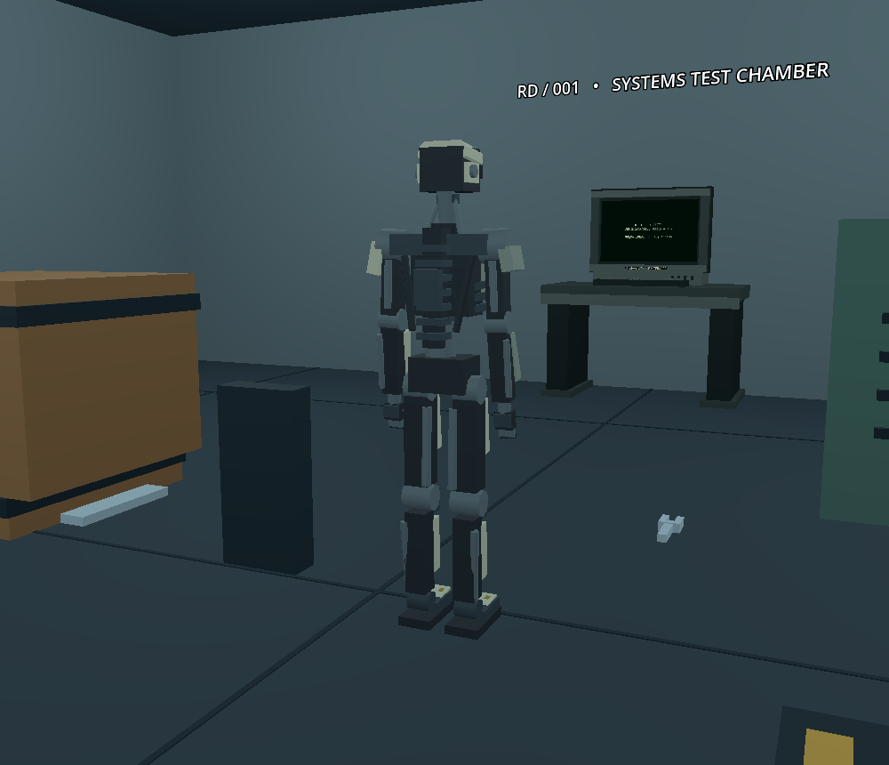
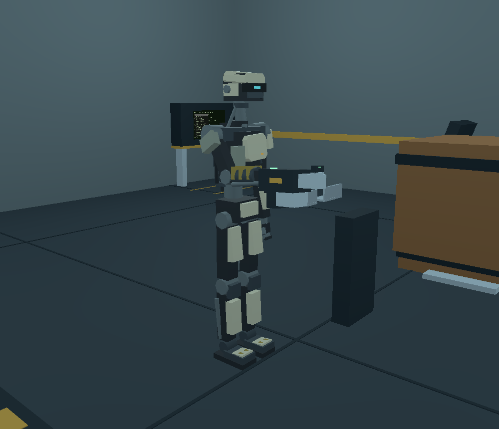
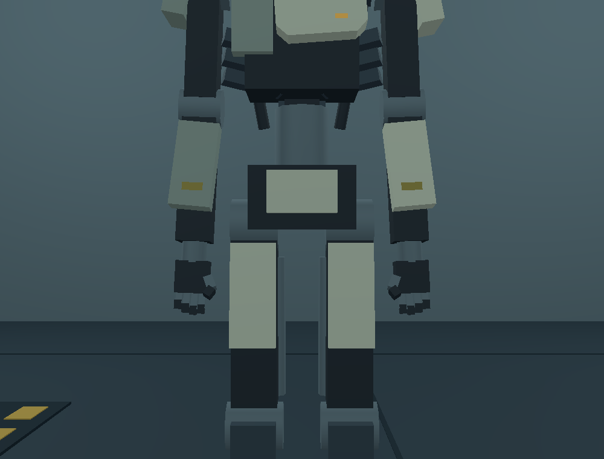

# ICF-01 Wayfarer

The Wayfarer is a procedural industrial android built from rigid, replaceable visual modules. Its stable chassis ID is `icf01.wayfarer`. The neutral model is approximately 1.84 m tall. Otis’s capsule, camera rig, AndroidChassis stats and interaction systems remain authoritative.





## Inspection and animation

Press **K** in a debug build to cycle the front-quarter view, rear-quarter view and first person. Move and turn normally to see the joints articulate. The inspection camera pulls in near solid geometry. Gameplay aim still uses the existing first-person camera. Returning to first person gives you the same aim, equipment and interaction state. A station camera ends inspection.

The pose driver reads horizontal velocity, turn rate, camera pitch and the equipment/manipulation state. It blends idle stabilization, a mechanical walk cycle, turns, carrying and reaching. There is no separate run input in the current controller. Floor contact uses the existing capsule. The joints use authored angles without foot or hand IK.

## Visual hierarchy

```text
Otis (CharacterBody3D and gameplay)
├── CollisionShape3D
├── Camera3D → EquipmentAnchor
├── PrecisionPlacement
├── Equipment
└── ICF01_Wayfarer (visual rig)
    ├── CoreChassis
    │   ├── HeadMount → HeadModule
    │   ├── Left/RightShoulderMount → UpperArm
    │   │   └── ElbowConnection → Forearm → WristConnection → Hand
    │   ├── Left/RightHipMount → Thigh
    │   │   └── KneeConnection → Shin → AnkleConnection → Foot
    │   ├── RearEquipmentMount
    │   └── WaistEquipmentMount
    └── WayfarerInspectionCamera
```

## Module contract

Use metres and unit scale. The assembled character's origin is at floor level, with **+Y** up and **−Z** forward. A module’s root pivot belongs at its proximal joint with an identity transform relative to its parent socket. Limb lengths are expressed along local **−Y** at rest. Use direct-child `Marker3D` nodes with the names below. Wrap imported meshes or a rigged glTF in a Godot scene exporting that contract. A compatible visual scene can replace a procedural scene in the module definition. Animation expects equivalent pivots and joint orientation.

| Module | Mount interface | Socket names |
| --- | --- | --- |
| Core | `chassis_root` | `HeadMount`, `LeftShoulderMount`, `RightShoulderMount`, `LeftHipMount`, `RightHipMount`, `RearEquipmentMount`, `WaistEquipmentMount` |
| Head | `head` | None required |
| Upper arm | `shoulder` | `ShoulderConnection`, `ElbowConnection` |
| Forearm | `elbow` | `ElbowConnection`, `WristConnection`, `ForearmAccessoryMount` |
| Hand | `wrist` | `WristConnection`, `PrimaryGrip`, `ToolAlignment` |
| Thigh | `hip` | `HipConnection`, `KneeConnection` |
| Shin | `knee` | `KneeConnection`, `AnkleConnection` |
| Foot | `ankle` | `AnkleConnection` |

Each definition under `scenes/character` declares its ID, category, interface, scene, sockets and optional cosmetic label. The service forearm replaces either arm through `replace_forearm(side_index, definition)`, using indices 0 for left and 1 for right. The replacement must match the current wrist transform. The same hand and tool socket survive the swap. There is no customization UI. The rear and waist mounts can accept accessories and have no inventory role yet.

First person hides the body and uses the established camera-relative item presentation. Inspection places a render-only copy of the equipped item at the right hand’s `ToolAlignment`. The real equipment retains its gameplay transform and state, including Uni-Bolt sight alignment and workpiece stabilization while aiming. Generic items use their visual origin for the grip, while the Uni-Bolt uses its modeled handle offset. The manipulation pose is a general reach pose and does not track individual contact points.

## Revision A



The mirrored thumb joints and finger order distinguish the left and right manipulators. Both hands retain the original wrist and grip transforms. Future third-person animation cleanup will decouple the projected Uni-Bolt from head pitch.
